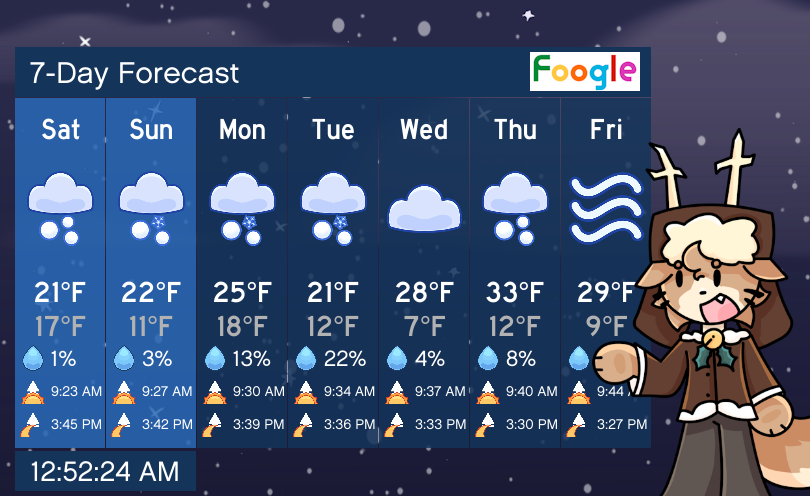

# Mittens Forecast Widget
A forecast widget inspired by the fishing `&forecast` command in PolyBot.

Using actual weather forecast data, the widget can display three different time intervals:
- 7 Days
- Hourly
- 15 Minutes

## Requirements
- An internet connection
- Java 21+

## Installation
Ensure you have at least Java 21 installed beforehand.
1. Download the latest build from the Releases tab
2. Place the build into a folder where you want to run it in.
3. Run it
4. Follow the instructions and guide the program displays

## FAQ
- Launching it gives me "A Java Exception has occurred" or similar
  - This is caused by having a version of Java installed that is too old.
  - You can check the version installed by running `java -version` in a command prompt.
  - Anything older than 21 will not work.
- I can't view any forecasts at all!
  - The API the widget uses occasionally drops dead for some reason, try again later.
- How do I open the settings?
  - Right click on the forecast widget to open a menu. Click on `Settings`.
  - Right click on the tray icon and click on `Open Settings`.
- How do I move the widget when its in borderless mode?
  - You can use the arrow keys to move the widget around.
  - Hold down Ctrl and then press the arrow keys to move it faster.

## Credits
- [Open-Meteo](https://open-meteo.com/) - Forecast Data
- [olliedid_that](https://guns.lol/olliedid_that) - Mittens sprite & Weather icons
- [tallcakes](https://tallcakes.neocities.org/) - Forecast backgrounds & Weather overlays
- [loreleidawitch](https://necromancyfordummies.straw.page/) - Aided in writing additional dialogue quips for Mittens

